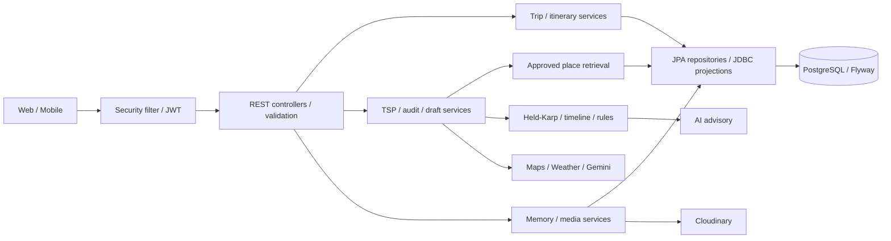

# Backend: kiến trúc, luồng dữ liệu và đợt tinh gọn 12/11/2026

## Phạm vi và kết luận

Đọc mã nguồn backend Java 21 / Spring Boot 4.1.0, lần theo controller, service, repository,
entity, migration và test của các luồng chính. Trước thay đổi có 292 file Java production và
89 file Java test. Đây là phân tích source và kiểm chứng bằng test/microbenchmark cục bộ;
không phải kết quả load test production hay chứng nhận đã tìm hết lỗi.

Kiến trúc thực tế là **modular layered monolith**, package theo nghiệp vụ. Nền tảng này phù
hợp để tiếp tục phát triển; chưa có bằng chứng cần microservice, message broker hay một tầng
interface mới cho mọi service. Hệ thống chưa phải Clean Architecture tách biệt hoàn toàn:
thuật toán còn nhận JPA `Place`, các module trip/itinerary/planning phụ thuộc qua lại, và
cùng một aggregate được truy cập bằng cả JDBC lẫn JPA.

Đợt thay đổi giữ endpoint, request/response đang dùng, công thức tính, quy tắc ownership,
khóa, version, transaction và migration đã phát hành. Không xóa cột hay dữ liệu DB.
Sau tinh gọn còn 283 file Java production và 87 file Java test. Diff source/test giảm ròng
1.037 dòng, bao gồm việc bổ sung regression tests và di chuyển logic TSP sang service.

Các điểm vào để đọc code theo báo cáo:
[Auth](../src/main/java/com/travel/auth/service/impl/AuthServiceImpl.java),
[Trip CRUD](../src/main/java/com/travel/trip/service/TripCrudService.java),
[Itinerary](../src/main/java/com/travel/itinerary/service/impl/ItineraryServiceImpl.java),
[Audit pipeline](../src/main/java/com/travel/planning/service/TripOptimizationServiceImpl.java),
[Day routing](../src/main/java/com/travel/maps/service/TripDayRoutingService.java),
[Draft](../src/main/java/com/travel/planning/draft/service/DraftService.java),
[Retrieval](../src/main/java/com/travel/planning/retrieval/service/PlaceRetrievalService.java),
[Memory](../src/main/java/com/travel/memory/service/impl/MemoryServiceImpl.java),
[Media cleanup](../src/main/java/com/travel/media/service/MediaDeletionService.java).

## Bản đồ module

| Module | Trách nhiệm và dữ liệu chính |
|---|---|
| `security`, `auth`, `user` | JWT, auth-state projection, refresh/action token, Google challenge, email, profile và permission |
| `trip` | CRUD/version/idempotency chuyến đi, ngày đi, pool địa điểm `trip_places` |
| `itinerary` | Lịch chính, stop theo ngày, giờ đến/thời lượng, day settings, lưu/apply đề xuất |
| `planning.algorithm`, `timeline`, `rule` | Held–Karp, tính khoảng cách, dựng timeline và phát hiện xung đột |
| `planning.ai` | Copilot nhận lịch đã tính và các vấn đề để đưa khuyến nghị |
| `planning.ai.intent`, `retrieval`, `draft` | Nhận preferences/text, tìm địa điểm đã duyệt, phân bổ và tạo bản nháp; bật trong `dev`/`rag-demo` |
| `maps`, `place` | Routing/matrix Mapbox, search/geocoding, catalog và địa điểm riêng của user |
| `weather` | Provider/fallback, forecast và current weather |
| `memory`, `media` | Journal, upload có fingerprint, receipt xóa ảnh và cleanup có retry |
| `home` | Read projections cho dashboard và tiến trình khám phá |
| `common`, `config`, `health` | Error envelope, validation, auditing, cấu hình và health |



Sơ đồ mô tả các tuyến xử lý chính; rule evaluation có thể dùng weather provider. Lưu lịch
là một thao tác riêng, không phải tác dụng phụ của lời gọi AI.

## Luồng dữ liệu từ đầu đến cuối

### 1. Xác thực và request có đăng nhập

`AuthController` → `AuthServiceImpl` → khóa user → BCrypt/kiểm tra trạng thái →
`AuthTokenIssuer` → access JWT + refresh token, lưu hash refresh trong PostgreSQL.
Refresh kiểm chữ ký/type/sessionVersion, khóa user rồi consume token bằng câu lệnh DB;
token đã dùng không được dùng lại. Google token verification và liên kết identity có
luồng challenge/link-ticket riêng; không gộp chúng vào login mật khẩu khi tinh gọn.

Request tiếp theo đi qua `JwtAuthenticationFilter`: parse JWT một lần → đọc
`UserRepository.AuthState` → đối chiếu email, trạng thái và sessionVersion → tạo
SecurityContext → controller. Một query auth-state/request là đánh đổi cho khả năng
thu hồi phiên khi reset/khóa tài khoản; bỏ nó sẽ thay đổi hành vi bảo mật.

### 2. Tạo/đọc/sửa chuyến đi

`TripController` → `TripCrudService` → `TripCrudRepository` (JDBC). Create chuẩn hóa
request và fingerprint, sử dụng create key/unique constraint để replay không sinh thêm
chuyến đi. Update kiểm ownership, khóa row, đối chiếu version, đánh giá ảnh hưởng ngày đi,
rồi update metadata/ngày trong transaction. Read/list dùng projections và pagination,
không tải nguyên graph JPA để dựng một trang danh sách.

Trip status lưu DB và mode hiển thị theo ngày là hai khái niệm khác nhau. `TripCalendar`
tính PLANNING/LIVE/RECAP theo múi giờ nghiệp vụ; không thay mode bằng một status mới.

### 3. Thêm địa điểm và lưu lịch theo ngày

`TripServiceImpl` khóa aggregate chuyến đi, kiểm mutable/ownership, resolve `Place` thấy
được bởi user rồi tạo/cập nhật `TripPlace`. Đây là membership/pool, khác với stop trong
`ItineraryItem`. `DayScheduleService` chuẩn bị routing/timeline ngoài write transaction;
khi commit, `ItineraryServiceImpl` kiểm lại trip version và itinerary updatedAt trước khi
lưu stop/settings. Điều này tránh giữ connection/khóa trong lúc chờ provider, đồng thời
không áp dụng lịch được tính từ snapshot cũ.

Không gộp `TripPlace` và `ItineraryItem`: một địa điểm thuộc pool có thể chưa được xếp
lịch; ngày bị xóa có thể unschedule appointment mà vẫn giữ membership/dữ liệu lịch sử.

### 4. TSP và audit lịch trình

`TspOptimizationController` → `TspOptimizationService` → DTO/đầu-cuối →
`HeldKarpSolver` → cost matrix → optimal ordering → response/legs.
Luồng này vẫn dùng khoảng cách Haversine và công thức thời gian hiện có.

`ItineraryOptimizationController` / itinerary optimize → `TripOptimizationServiceImpl` →
batch đọc địa điểm INTERNAL để bổ sung metadata thiếu → xử lý tiến độ/điểm xuất phát →
Held–Karp → `TimelineEngine` → `RuleEvaluatorService` → trả lịch và vấn đề. Copilot chỉ
đưa khuyến nghị; apply là request riêng có validation. Không thay Haversine bằng road
distance hoặc thay Held–Karp bằng heuristic trong đợt này.

### 5. Tối ưu đường đi của một ngày đã lưu

`TripDayRouteController` → `TripDayRoutingService` → JDBC đọc ngày, stop, settings →
`MapboxDirectionsService.matrix` lấy distances/durations có hướng →
`HeldKarpSolver.solveFixedStart` → so sánh với thứ tự ban đầu → proposal.
Chỉ đề xuất thứ tự mới nếu cả distance và duration không tăng. Stop đã ghé được giữ;
origin/return leg được tính nhưng không bị trả thành place ID của lượt ghé.

Mapbox cung cấp chi phí đường; Held–Karp thực hiện tối ưu. Adapter gọi Mapbox
Optimization API cũ không còn thuộc luồng này và đã được xóa.

### 6. Intent → retrieval → draft

`DraftController` → `DraftService` → `TravelIntentService` phân tích text hoặc preferences
có cấu trúc → validation → lexical search + query embedding/semantic search → cộng điểm
RRF → hydrate row công khai, đã duyệt, còn tồn tại → loại tag bị loại trừ → sort/limit →
kiểm required places → phân bổ ngày → Held–Karp/timeline và bounded repair → theme →
response draft. Weather advisory chạy trên executor có queue giới hạn và deadline.

Embedding hỏng có lexical fallback. Allocation/theme có fallback riêng; thiếu intent cần
người dùng bổ sung thay vì tự đoán. `AiRequestContext`/retry quản lý deadline theo request
cho luồng RAG. Draft không tự ghi đè trip/lịch đã lưu.

### 7. Memory, ảnh và dashboard

`MemoryController` → `MemoryServiceImpl`: kiểm ownership/membership, fingerprint create
request, lưu/replay memory. List phân trang ID trước, batch fetch media sau để tránh
pagination trên collection fetch join. Update note có version; delete có trạng thái lưu DB.

Upload: kiểm ảnh → fingerprint → kiểm upload đã có → Cloudinary với public ID ổn định →
transaction ngắn attach metadata; upload hoàn tất sau khi memory bị xóa được đưa sang
cleanup. Delete ảnh reserve receipt trong DB → gọi Cloudinary ngoài transaction → finish
hoặc retry. Giữ receipt/retry vì DB và Cloudinary không có distributed transaction.

Home dùng `HomeRepository` và `TripCrudService` dựng projection theo owner/ngày. Catalog,
discovery, weather và geocoding đi qua service/provider; không đổi contract của chúng.

## Những phần đã cải thiện

| Vấn đề có bằng chứng | Thay đổi | Tác động |
|---|---|---|
| Held–Karp dùng `double[2^n][n]` và `int[2^n][n]` | Flat `double[]` và `byte[]` cho parent; node ≤16 | Giảm số object và allocation, giữ recurrence, thứ tự duyệt/tie-break, độ chính xác double |
| Enrichment gọi DB cho từng location có ID | Một query `findByIdInAndSource`, lookup qua map | Từ N lượt đọc logic xuống tối đa 1/ngày; không query khi không có ID; vẫn chỉ INTERNAL |
| Retrieval hydrate toàn bộ catalog dù lexical/semantic mỗi nhánh giới hạn 40 ID | Query chỉ các ID có score; dùng set cho cờ lexical/semantic | Tối đa 80 candidate rows trước exclusion/limit thay vì toàn catalog; giữ điểm/thứ tự xếp hạng |
| `generateItinerary` không có production caller | Xóa 10 class của prompt/context/validator/fallback/response cũ, method và constructor liên quan | Bỏ nhánh chết và bean/dependency chỉ phục vụ nhánh đó; giữ Copilot/draft đang dùng |
| Mapbox Optimization API không có production caller | Xóa hai overload `optimize`, record `OptimizedOrder` và test riêng của nhánh cũ | Chỉ giữ route/matrix; sửa dashboard fixture theo Matrix + Held–Karp |
| Repository còn derived queries/projection của flow cũ | Xóa 16 method không còn caller và projection `TripCounts` | Bỏ lựa chọn persistence dễ dùng nhầm; giữ các method dùng trong test tích hợp |
| `Trip.transportation` và `Trip.budget` không có caller; budget hiện dùng `budget_amount` | Gỡ hai field mapping và import BigDecimal | Không đọc/ghi hai cột cũ qua JPA; dữ liệu/cột lịch sử vẫn giữ nguyên |
| Controller TSP chuẩn bị endpoint, gọi thuật toán và dựng kết quả | Chuyển nguyên phần xử lý sang một service cụ thể | Controller chỉ nhận/validate/gọi service/trả HTTP; không thêm interface cho một implementation |
| Parse weekly hours trong optimizer nhưng kết quả bị bỏ | Bỏ tính toán chết và dependency ObjectMapper; dùng một constructor injection | Giữ nguyên output hiện tại; weekly hours do client gửi vẫn được TimelineEngine dùng |
| Test logging phụ thuộc root logger do test Spring trước đó thay đổi | Set INFO cho logger cần kiểm tra và restore sau test | Test độc lập với thứ tự; không đổi cấu hình logging production |

Không xóa `description`, `constraints`, `preferences`, hoặc request `media` chỉ vì trông
giống dữ liệu cũ: chúng còn caller hoặc có semantics validation/compatibility. Không xóa
entity/table chỉ dựa vào số import; JPA, JDBC, Flyway và dữ liệu cũ đều phải được xét.

## Phép đo Held–Karp cục bộ

So sánh solver từ HEAD trước thay đổi và solver mới, cùng Java 21, cùng directed matrix
16×16 với seed 42, start=0/end=15. Kiểm tra hai solver trả cùng path; warm-up 5 lần mỗi
solver, đo 10 lần bằng `ThreadMXBean.getThreadAllocatedBytes` và `nanoTime`.

| Chỉ số | Trước | Sau |
|---|---:|---:|
| Bytes cấp phát/lần solve | 15.205.400 | 9.438.232 |
| Thời gian trung bình/lần solve | 59,753 ms | 40,539 ms |

Allocation giảm khoảng **37,9%**. Thời gian giảm khoảng **32,2% trong phép đo này**;
không suy rộng thành SLA/p95 production. Đây là microbenchmark trong một JVM, không có
JMH forks hay load concurrency. Độ phức tạp vẫn O(n²·2ⁿ) thời gian và O(n·2ⁿ) bộ nhớ.
Không nâng giới hạn 16 điểm. Query-count cải thiện được suy ra từ call sites và regression
tests; chưa đo latency DB hay query plan trên dữ liệu production.

## Rủi ro còn lại và thứ tự xử lý

Các mục dưới đây phân biệt vấn đề thấy trong source với bottleneck đã được đo. Không
âm thầm đổi hành vi để xử lý chúng trong một đợt refactor giữ nguyên chức năng.

| Ưu tiên | Bằng chứng/vấn đề | Hướng xử lý tiếp theo |
|---|---|---|
| Cao khi phục vụ tải lớn | Public TSP vẫn có chi phí mũ và allocation theo mỗi request; giới hạn số điểm không giới hạn số request đồng thời | Đo concurrency/heap rồi đặt quota/concurrency budget phù hợp ở edge/service; đây là thay đổi admission behavior cần chốt riêng |
| Cao cho tính nhất quán | `TripCrudRepository` dùng JDBC còn itinerary/trip-place dùng JPA trên cùng aggregate | Giữ một transaction manager và quy tắc lock/version; nếu kết hợp hai kiểu ghi trong cùng persistence context phải flush/refresh rõ, kiểm tra race; không mặc định đây là lỗi đang xảy ra |
| Cao khi auth đông | `AuthServiceImpl.login` chạy BCrypt sau `lockByEmail` trong transaction | Đo lock wait/pool/BCrypt; phương án snapshot → BCrypt ngoài transaction → khóa và kiểm lại hash/session/state cần concurrency test riêng |
| Trung bình | Multi-day gọi `optimizeAndAuditItinerary` cho từng ngày, tạo Copilot từng ngày rồi không đưa Copilot đó vào `DayScheduleResponse`; sau đó có thể gọi Copilot toàn chuyến | Tách deterministic daily audit khỏi AI orchestration; trước khi bỏ lời gọi phải thống nhất semantics lỗi provider và cổng INFO/IMPORTANT vì single-day và multi-day hiện khác nhau |
| Trung bình | Weekly hours từ DB chưa được đưa vào timeline của audit; code cũ parse nhưng bỏ kết quả | Nếu muốn bổ sung, phải coi là sửa hành vi nghiệp vụ và test giờ mở cửa theo thứ/ngày; đợt này chỉ bỏ parse vô ích |
| Trung bình | `TravelIntentService` và `DraftService` còn đọc catalog để resolve/rà soát; index loop đọc từng trạng thái embedding | Dataset demo nhỏ nên chưa rewrite; khi mở rộng nhiều tỉnh cần query có filter, batch index-state và xử lý theo batch, giữ kiểm approved/current-content |
| Trung bình | `PlaceRetrievalService.index` dùng AtomicBoolean, chỉ chống trùng trong một JVM | Khi chạy nhiều instance, thiết kế job ownership/DB lock nếu cần ngăn index trùng; không coi AtomicBoolean là distributed lock |
| Trung bình | Trip/home SQL có correlated count, lịch chính được fetch toàn bộ; response nhỏ không chứng minh SQL rẻ | Dùng EXPLAIN ANALYZE và số đo trên trip nhiều stop/memory; chỉ thêm index hoặc aggregate projection dựa vào plan; không đổi LAZY thành EAGER toàn cục |
| Trung bình | `HeldKarpSolver`, timeline nhận JPA `Place`; trip/itinerary/planning tạo dependency vòng ở cấp module | Nếu cần tách module độc lập, dùng value input riêng cho thuật toán và application boundary rõ; chưa thêm DTO/port mới hàng loạt vì tăng scope/churn |
| Trung bình | Copilot transport và RAG structured transport có cấu hình/deadline/fallback riêng | Xem lại hai contract trước khi hợp nhất; không tái sử dụng một client chỉ vì đều gọi Gemini rồi làm thay đổi timeout/error mapping |

Các điểm đang làm tốt cần giữ: ownership ở service/SQL, projection auth-state không lấy
password hash, batch fetch trong list memory, bounded executor cho email/weather, provider I/O
ngoài write transaction của routing/upload/delete, khóa/version khi apply lịch, validation
của dữ liệu AI và schema migration có lịch sử.

## Kiểm chứng

Đã chạy trên mã nguồn cuối:

```powershell
mvn -o "-Dmaven.repo.local=C:/Users/DELL/.m2/repository" clean test
```

Kết quả: **BUILD SUCCESS — 533 tests, 0 failures, 0 errors, 0 skipped**, thời gian
3 phút 27 giây. Biên dịch sạch 283 file production và 87 file test; integration test dùng
PostgreSQL 17/pgvector qua Testcontainers, provider Internet được giả lập tại boundary.
`git diff --check -- backend/src` cũng thành công. Log lần chạy cuối:
`backend/architecture-verified-tests.log` (artifact local, không đưa vào Git).

Các regression bổ sung gồm: optimality so với vét cạn cho directed costs/endpoint modes,
tie order, 16 điểm, metadata override/fallback, không đọc private places qua public batch,
hydrate candidate đã duyệt, dữ liệu cột legacy còn nguyên sau JPA update, Copilot HTTP/error/fallback,
và dashboard tối ưu origin/return bằng road matrix.

Không gọi provider Internet thật, không load test production, không thay migration đã phát hành,
không xóa dữ liệu DB hiện có và không commit/push tự động.
