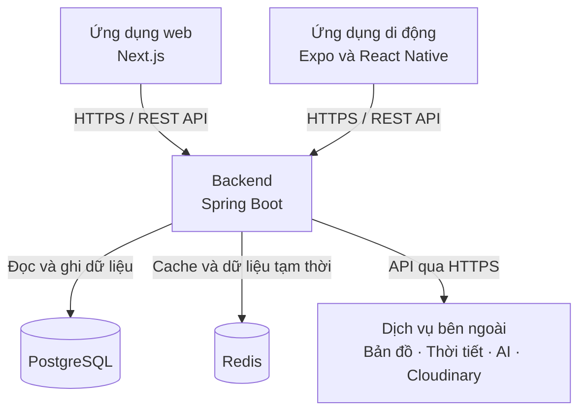
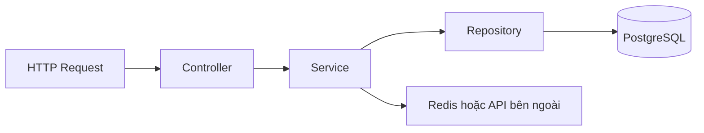
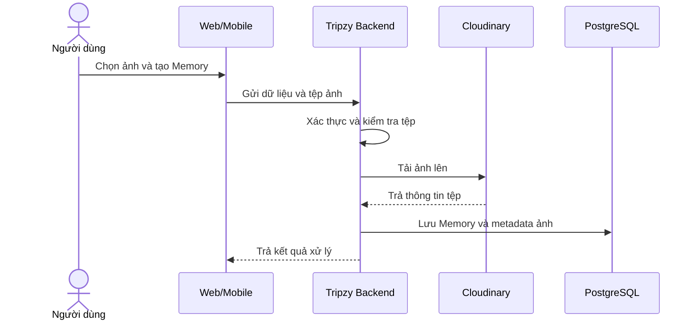

# 4.1. Kiến trúc tổng thể

## 4.1.1. Tổng quan kiến trúc

Tripzy được xây dựng theo **kiến trúc nguyên khối phân lớp** (*Layered Monolithic Architecture*), trong đó toàn bộ nghiệp vụ backend được triển khai trong một ứng dụng Spring Boot duy nhất. Mã nguồn được tổ chức theo từng nhóm chức năng nghiệp vụ (*package-by-feature*); bên trong mỗi package tiếp tục được phân chia thành các lớp như `controller`, `dto`, `service`, `repository`, `entity` và `enums` tùy theo nhu cầu của chức năng.

Kiến trúc này phù hợp với phạm vi MVP vì có cấu trúc rõ ràng, thuận tiện cho phát triển, kiểm thử và triển khai, đồng thời hạn chế độ phức tạp của kiến trúc phân tán. Trong giai đoạn hiện tại, hệ thống không sử dụng Spring Modulith và không tách thành các microservice độc lập.

Hệ thống bao gồm các thành phần chính:

- Ứng dụng web được xây dựng bằng Next.js.
- Ứng dụng di động được xây dựng bằng Expo và React Native.
- Backend được xây dựng bằng Java và Spring Boot.
- PostgreSQL lưu trữ dữ liệu nghiệp vụ chính.
- Redis hỗ trợ lưu trữ tạm thời và cache.
- Cloudinary lưu trữ hình ảnh của người dùng.
- Các dịch vụ API bên ngoài cung cấp dữ liệu bản đồ, định tuyến, thời tiết và trí tuệ nhân tạo.



## 4.1.2. Kiến trúc frontend

Tripzy cung cấp giao diện trên hai nền tảng là web và thiết bị di động. Frontend chịu trách nhiệm hiển thị dữ liệu, tiếp nhận thao tác của người dùng và gửi yêu cầu đến backend thông qua REST API.

- **Ứng dụng web:** được phát triển bằng Next.js, phục vụ các chức năng quản lý và sử dụng hệ thống trên trình duyệt.
- **Ứng dụng di động:** được phát triển bằng Expo và React Native, hỗ trợ các chức năng gắn với quá trình thực hiện chuyến đi như sử dụng GPS, check-in, chụp ảnh và tạo Memory.

Frontend không truy cập trực tiếp PostgreSQL, Redis, Cloudinary hoặc các dịch vụ bên ngoài. Các thao tác cần dữ liệu hoặc xử lý nghiệp vụ đều được thực hiện thông qua backend nhằm bảo đảm tính nhất quán, kiểm soát quyền truy cập và bảo vệ thông tin cấu hình của hệ thống.

## 4.1.3. Kiến trúc backend

Backend là thành phần trung tâm của Tripzy, chịu trách nhiệm cung cấp API, xác thực và phân quyền, xử lý nghiệp vụ, truy cập dữ liệu, thực hiện thuật toán và tích hợp với các dịch vụ bên ngoài.

Mã nguồn backend được đặt trong package gốc `com.travel` và được tổ chức theo các nhóm chức năng chính như sau:

```text
com.travel
├── auth
├── common
├── config
├── health
├── place
├── planning
│   └── algorithm
├── security
├── trip
├── user
│   ├── controller
│   ├── dto
│   ├── entity
│   ├── enums
│   ├── repository
│   └── service
└── TravelApplication.java
```

Các package được chia thành hai nhóm:

| Nhóm package | Thành phần | Vai trò |
|---|---|---|
| Nghiệp vụ | `auth`, `user`, `place`, `trip`, `planning` | Cài đặt các chức năng chính của hệ thống |
| Dùng chung và hạ tầng | `common`, `config`, `security`, `health` | Cung cấp cấu hình, bảo mật, xử lý dùng chung và kiểm tra trạng thái hệ thống |

Trong mỗi package nghiệp vụ, các lớp được tổ chức theo trách nhiệm:

| Lớp | Vai trò |
|---|---|
| `controller` | Tiếp nhận HTTP request, gọi lớp nghiệp vụ và trả HTTP response |
| `dto` | Biểu diễn dữ liệu đầu vào và đầu ra giữa frontend với backend |
| `service` | Xử lý nghiệp vụ và điều phối các thao tác của chức năng |
| `repository` | Truy cập và thao tác với dữ liệu trong PostgreSQL |
| `entity` | Biểu diễn thực thể được ánh xạ với cơ sở dữ liệu |
| `enums` | Định nghĩa các trạng thái hoặc kiểu dữ liệu cố định của chức năng |

Luồng xử lý phổ biến trong backend được thực hiện theo thứ tự:



Việc tổ chức theo package chức năng giúp các thành phần liên quan đến cùng một nghiệp vụ được đặt gần nhau, dễ tìm kiếm và bảo trì. Phân lớp bên trong package giúp tách biệt trách nhiệm giữa tiếp nhận yêu cầu, xử lý nghiệp vụ và truy cập dữ liệu.

## 4.1.4. Cơ chế giao tiếp

### Giao tiếp giữa frontend và backend

Ứng dụng web và ứng dụng di động giao tiếp với backend thông qua REST API trên giao thức HTTPS. Dữ liệu thông thường được trao đổi ở định dạng JSON. Đối với hình ảnh, frontend sử dụng `multipart/form-data` để gửi tệp đến backend.

Các API yêu cầu đăng nhập sử dụng access token theo cơ chế JWT. Backend xác thực token và kiểm tra quyền truy cập trước khi thực hiện nghiệp vụ. Frontend không được tự quyết định quyền truy cập hoặc tin cậy dữ liệu chỉ dựa trên trạng thái giao diện.

### Giao tiếp bên trong backend

Các thành phần bên trong backend giao tiếp thông qua lời gọi phương thức trong cùng ứng dụng Spring Boot. Controller gọi service để thực hiện nghiệp vụ; service sử dụng repository để truy cập dữ liệu hoặc gọi các thành phần tích hợp khi cần thiết.

Do được triển khai dưới dạng một ứng dụng nguyên khối, hệ thống chưa cần sử dụng message broker như Kafka hoặc RabbitMQ trong phạm vi MVP.

### Giao tiếp với dịch vụ bên ngoài

Backend kết nối với các dịch vụ bản đồ, định tuyến, thời tiết, AI và Cloudinary thông qua API trên giao thức HTTPS. Khóa API và thông tin xác thực của các dịch vụ được quản lý tại backend thông qua biến môi trường hoặc cấu hình triển khai, không được đưa trực tiếp vào mã nguồn frontend.

Khi dịch vụ bên ngoài tạm thời không khả dụng, backend cần trả về thông báo phù hợp và hạn chế làm ảnh hưởng đến dữ liệu nghiệp vụ đã được lưu trong hệ thống.

## 4.1.5. Cơ sở dữ liệu PostgreSQL

PostgreSQL là hệ quản trị cơ sở dữ liệu quan hệ được sử dụng để lưu trữ dữ liệu nghiệp vụ chính của Tripzy, bao gồm người dùng, chuyến đi, địa điểm, lịch trình, check-in, Memory và các thông tin liên quan.

Backend truy cập PostgreSQL thông qua Spring Data JPA và Hibernate. Các thao tác làm thay đổi nhiều dữ liệu có liên quan được xử lý trong transaction nhằm bảo đảm tính nhất quán. PostgreSQL là nguồn dữ liệu chính của hệ thống; dữ liệu trong Redis hoặc các dịch vụ lưu trữ bên ngoài không thay thế vai trò này.

Hình ảnh không được lưu trực tiếp dưới dạng dữ liệu nhị phân trong PostgreSQL. Cơ sở dữ liệu chỉ lưu metadata và thông tin tham chiếu đến tệp trên Cloudinary.

Thiết kế bảng, khóa, cột và quan hệ giữa các bảng sẽ được trình bày tại mục 4.3.

## 4.1.6. Redis và cơ chế cache

Redis được sử dụng trong phạm vi MVP như một hệ thống lưu trữ dữ liệu trong bộ nhớ, hỗ trợ giảm thời gian phản hồi và hạn chế số lần gọi lặp lại đến các dịch vụ bên ngoài.

Redis có thể được sử dụng cho các nhóm dữ liệu như:

- Kết quả tra cứu địa điểm, khoảng cách và thời gian di chuyển.
- Dữ liệu thời tiết có thời hạn sử dụng ngắn.
- OTP, giới hạn tần suất yêu cầu và các dữ liệu tạm thời khác.
- Một số kết quả xử lý có thể tái sử dụng trong khoảng thời gian nhất định.

Dữ liệu cache phải có thời gian hết hạn phù hợp với từng loại. Khi cache không tồn tại hoặc đã hết hạn, backend lấy dữ liệu từ nguồn chính, trả kết quả cho người dùng và cập nhật lại cache. Redis không lưu trữ dữ liệu nghiệp vụ duy nhất và việc mất dữ liệu cache không được làm mất dữ liệu chuyến đi của người dùng.

Các chiến lược cache, quy ước khóa và thời gian hết hạn cụ thể sẽ được xác định trong phần thiết kế kỹ thuật liên quan.

## 4.1.7. Lưu trữ hình ảnh trên Cloudinary

Cloudinary được sử dụng để lưu trữ hình ảnh gắn với Memory và trải nghiệm chuyến đi. Để kiểm soát quyền truy cập và bảo vệ thông tin cấu hình, ảnh không được tải trực tiếp từ frontend lên Cloudinary mà đi qua backend.

Luồng xử lý tổng quát như sau:



Backend chịu trách nhiệm xác thực người dùng, kiểm tra quyền đối với chuyến đi, kiểm tra định dạng và kích thước tệp trước khi tải ảnh lên Cloudinary. Sau khi tải thành công, backend lưu các thông tin cần thiết như mã định danh tệp, đường dẫn truy cập và metadata vào PostgreSQL.

Chi tiết về bảng lưu ảnh, quy tắc giới hạn tệp, xử lý lỗi và cơ chế xóa ảnh sẽ được trình bày trong các phần thiết kế cơ sở dữ liệu và API.

## 4.1.8. Tích hợp bản đồ, thời tiết và AI

Tripzy sử dụng các dịch vụ API bên ngoài để bổ sung dữ liệu và khả năng xử lý mà hệ thống không tự xây dựng từ đầu:

| Dịch vụ | Vai trò trong hệ thống |
|---|---|
| Bản đồ và địa điểm | Tìm kiếm địa điểm, xác định tọa độ và hiển thị thông tin bản đồ |
| Định tuyến | Cung cấp khoảng cách, thời gian và tuyến đường di chuyển |
| Thời tiết | Cung cấp thông tin thời tiết theo địa điểm và thời gian |
| AI | Phân tích ngữ cảnh, đưa ra đề xuất, cảnh báo và giải thích |
| Cloudinary | Lưu trữ và phân phối hình ảnh |

Backend là thành phần duy nhất trực tiếp kết nối các API này. Dữ liệu nhận được được chuẩn hóa trước khi trả cho frontend hoặc sử dụng trong nghiệp vụ. Các đề xuất của AI chỉ mang tính tham khảo; người dùng vẫn quyết định áp dụng, chỉnh sửa hoặc bỏ qua.

## 4.1.9. Mô hình triển khai và khả năng mở rộng

Trong phạm vi MVP, Tripzy được triển khai theo mô hình đơn giản, phù hợp với sản phẩm thử nghiệm và nguồn lực của đồ án:

- Backend được đóng gói và triển khai như một ứng dụng Spring Boot duy nhất.
- PostgreSQL và Redis có thể chạy bằng Docker trong môi trường phát triển và thử nghiệm.
- Web frontend được triển khai độc lập với backend.
- Ứng dụng di động được cài đặt và chạy trên thiết bị của người dùng.
- Cloudinary cùng các dịch vụ bản đồ, thời tiết và AI được sử dụng dưới dạng dịch vụ bên ngoài.

Hệ thống chưa triển khai kiến trúc microservice, message broker, API Gateway hoặc cơ chế điều phối container phức tạp. Cách tiếp cận này giúp giảm chi phí vận hành và phù hợp với quy mô MVP.

Khi nhu cầu sử dụng tăng, backend có thể được mở rộng theo chiều ngang bằng cách triển khai nhiều instance phía sau bộ cân bằng tải. PostgreSQL và Redis được triển khai thành các dịch vụ dùng chung để các instance backend có thể truy cập thống nhất. Việc mở rộng này là định hướng tương lai, không phải yêu cầu bắt buộc của MVP.

## 4.1.10. Kết luận kiến trúc

Kiến trúc tổng thể của Tripzy được lựa chọn theo hướng đơn giản, khả thi và phù hợp với phạm vi đồ án. Backend sử dụng kiến trúc nguyên khối phân lớp, tổ chức mã nguồn theo từng package chức năng và không sử dụng Spring Modulith. PostgreSQL đóng vai trò lưu trữ dữ liệu chính, Redis hỗ trợ cache và dữ liệu tạm thời, trong khi hình ảnh được gửi qua backend để lưu trữ trên Cloudinary. Frontend web và mobile giao tiếp với backend qua REST API; mọi thao tác nghiệp vụ và kết nối dịch vụ bên ngoài được kiểm soát tập trung tại backend.

Kiến trúc này đáp ứng yêu cầu của MVP, đồng thời vẫn tạo nền tảng để hệ thống được mở rộng và hoàn thiện trong các giai đoạn tiếp theo.
