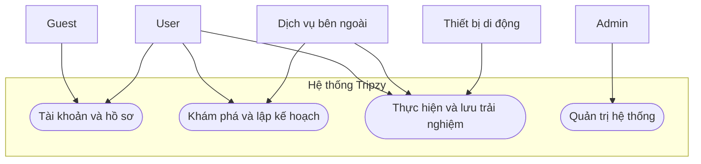
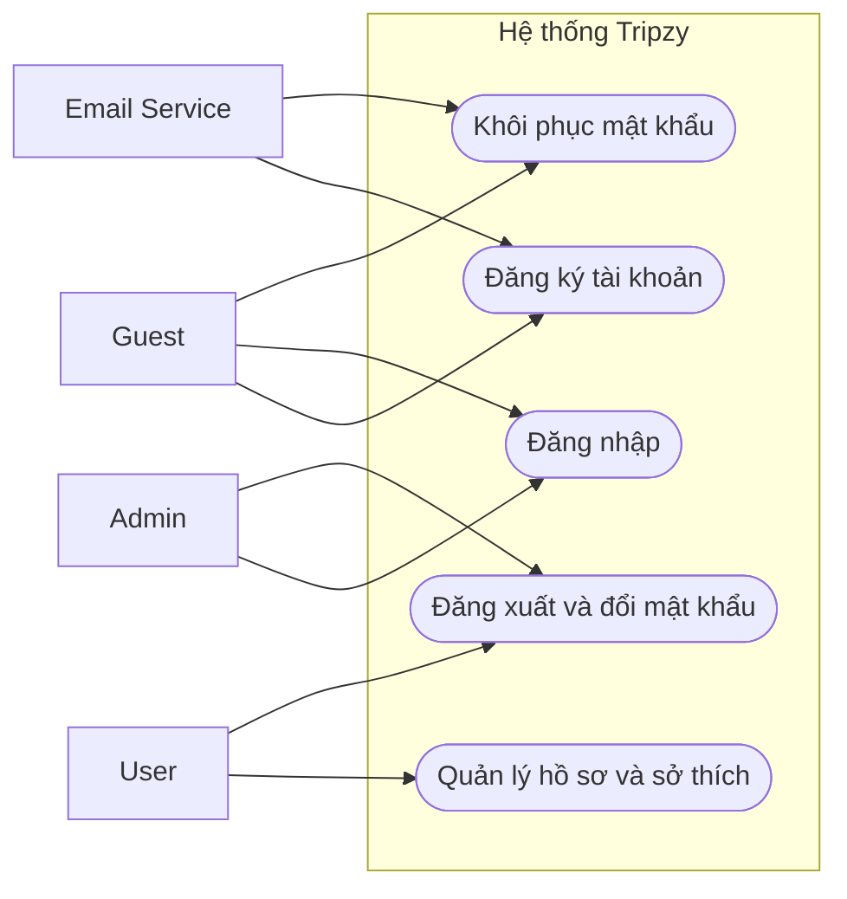
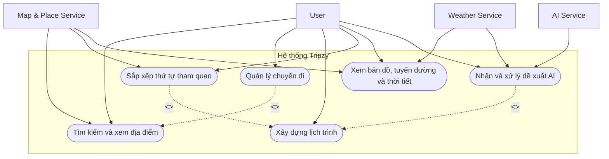
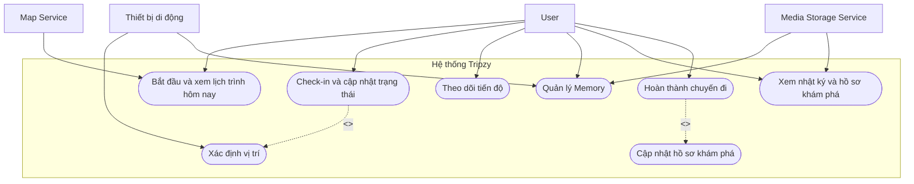
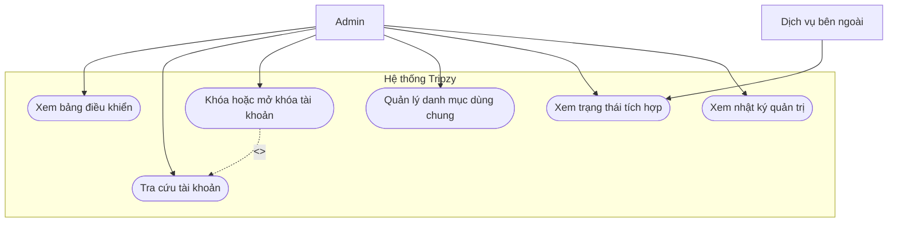

# 4. NHẬN DIỆN ACTOR, DANH SÁCH VÀ SƠ ĐỒ USE CASE TRIPZY

**Phiên bản:** 1.0  
**Phạm vi:** Sản phẩm khả dụng tối thiểu (MVP)  
**Liên kết:** Yêu cầu chức năng Tripzy phiên bản 1.0

---

## 4.1. Mục đích

Phần này xác định các tác nhân tương tác với Tripzy, xây dựng danh mục Use Case và mô hình hóa mối quan hệ giữa tác nhân với các chức năng chính của hệ thống. Đây là cơ sở để viết đặc tả Use Case chi tiết, thiết kế giao diện, API, cơ sở dữ liệu và test case.

## 4.2. Phạm vi hệ thống

Biên hệ thống Tripzy bao gồm ứng dụng web, ứng dụng di động, backend và cơ sở dữ liệu. Các dịch vụ bản đồ, thời tiết, AI, lưu trữ hình ảnh, gửi email và chức năng phần cứng của thiết bị nằm ngoài biên hệ thống, nhưng được xem là actor hỗ trợ vì Tripzy trao đổi dữ liệu với các thành phần này.

Trong MVP, Tripzy phục vụ người dùng du lịch cá nhân. Chức năng lập kế hoạch nhóm, đặt vé, đặt phòng, thanh toán và mạng xã hội du lịch không thuộc phạm vi Use Case.

## 4.3. Nhận diện actor

### 4.3.1. Actor chính

| Mã | Actor | Mô tả | Mục tiêu |
|---|---|---|---|
| ACT-01 | Guest | Người chưa đăng nhập hoặc chưa có tài khoản. | Đăng ký, đăng nhập hoặc khôi phục quyền truy cập tài khoản. |
| ACT-02 | User | Người dùng đã đăng nhập bằng tài khoản hợp lệ. | Lập kế hoạch, thực hiện chuyến đi, lưu giữ trải nghiệm và xem hồ sơ khám phá cá nhân. |
| ACT-03 | Admin | Người quản trị đăng nhập bằng tài khoản có vai trò quản trị. | Quản lý trạng thái tài khoản, dữ liệu danh mục dùng chung và theo dõi tình trạng tổng quan của hệ thống. |

### 4.3.2. Actor hỗ trợ

| Mã | Actor | Vai trò hỗ trợ |
|---|---|---|
| ACT-EXT-01 | Map & Place Service | Cung cấp địa điểm, tọa độ, ma trận khoảng cách, thời gian di chuyển và tuyến đường. |
| ACT-EXT-02 | Weather Service | Cung cấp dữ liệu dự báo thời tiết theo vị trí và thời gian. |
| ACT-EXT-03 | AI Service | Phân tích ngữ cảnh, tạo đề xuất và giải thích lịch trình. |
| ACT-EXT-04 | Media Storage Service | Lưu trữ và cung cấp đường dẫn truy cập hình ảnh. |
| ACT-EXT-05 | Email Service | Gửi email xác minh hoặc khôi phục mật khẩu khi chức năng được kích hoạt. |
| ACT-DEV-01 | Thiết bị di động | Cung cấp GPS, camera và thư viện ảnh theo quyền người dùng đã cấp. |

### 4.3.3. Nguyên tắc phân quyền actor

- Guest và User biểu thị hai trạng thái truy cập khác nhau; một người trở thành User sau khi đăng nhập thành công.
- Admin là vai trò quản trị riêng, không mặc nhiên kế thừa quyền truy cập dữ liệu riêng tư của User.
- User chỉ được thao tác trên hồ sơ, chuyến đi, lịch trình, check-in và Memory thuộc quyền sở hữu của mình.
- Admin chỉ được xem thông tin tài khoản cần thiết cho quản trị và số liệu tổng hợp; không được xem nội dung chuyến đi, vị trí hoặc Memory riêng tư nếu không có nghiệp vụ, căn cứ và quyền được quy định riêng.
- Actor hỗ trợ không trực tiếp sử dụng giao diện Tripzy; hệ thống trao đổi với các actor này thông qua API hoặc quyền của thiết bị.

## 4.4. Ma trận quyền ở mức tổng quan

| Nhóm chức năng | Guest | User | Admin |
|---|:---:|:---:|:---:|
| Đăng ký, đăng nhập, khôi phục mật khẩu | Có | Không áp dụng khi đang đăng nhập | Đăng nhập quản trị |
| Quản lý hồ sơ và sở thích cá nhân | Không | Dữ liệu của chính mình | Không |
| Tìm kiếm địa điểm | Không | Có | Không |
| Quản lý chuyến đi và lịch trình | Không | Dữ liệu của chính mình | Không |
| Tối ưu thứ tự và nhận đề xuất AI | Không | Có | Không |
| GPS, check-in và tiến độ chuyến đi | Không | Có | Không |
| Memory và hồ sơ khám phá | Không | Dữ liệu của chính mình | Không |
| Quản lý trạng thái tài khoản người dùng | Không | Không | Có |
| Quản lý danh mục dùng chung | Không | Không | Có |
| Xem thống kê hệ thống tổng hợp | Không | Không | Có |

## 4.5. Danh sách Use Case

### 4.5.1. Tài khoản và xác thực

| Mã Use Case | Tên Use Case | Actor chính | Actor hỗ trợ | Kênh | Ưu tiên |
|---|---|---|---|---|---|
| UC-AUTH-01 | Đăng ký tài khoản | Guest | Email Service | Web/Mobile | Must |
| UC-AUTH-02 | Đăng nhập | Guest, Admin | — | Web/Mobile | Must |
| UC-AUTH-03 | Khôi phục mật khẩu | Guest | Email Service | Web/Mobile | Should |
| UC-AUTH-04 | Đăng xuất | User, Admin | — | Web/Mobile | Must |
| UC-AUTH-05 | Đổi mật khẩu | User, Admin | — | Web/Mobile | Must |
| UC-AUTH-06 | Vô hiệu hóa tài khoản cá nhân | User | — | Web/Mobile | Should |

### 4.5.2. Hồ sơ và sở thích cá nhân

| Mã Use Case | Tên Use Case | Actor chính | Actor hỗ trợ | Kênh | Ưu tiên |
|---|---|---|---|---|---|
| UC-PROFILE-01 | Xem hồ sơ cá nhân | User | — | Web/Mobile | Must |
| UC-PROFILE-02 | Cập nhật hồ sơ cá nhân | User | Media Storage Service | Web/Mobile | Must |
| UC-PROFILE-03 | Quản lý sở thích du lịch | User | — | Web/Mobile | Must |
| UC-PROFILE-04 | Quản lý tùy chọn du lịch | User | — | Web/Mobile | Should |

### 4.5.3. Khám phá và lựa chọn địa điểm

| Mã Use Case | Tên Use Case | Actor chính | Actor hỗ trợ | Kênh | Ưu tiên |
|---|---|---|---|---|---|
| UC-PLACE-01 | Tìm kiếm và lọc địa điểm | User | Map & Place Service | Web/Mobile | Must |
| UC-PLACE-02 | Xem chi tiết địa điểm | User | Map & Place Service | Web/Mobile | Must |
| UC-PLACE-03 | Xem địa điểm trên bản đồ | User | Map & Place Service | Web/Mobile | Must |
| UC-PLACE-04 | Lưu địa điểm yêu thích | User | — | Web/Mobile | Could |

### 4.5.4. Quản lý chuyến đi

| Mã Use Case | Tên Use Case | Actor chính | Actor hỗ trợ | Kênh | Ưu tiên |
|---|---|---|---|---|---|
| UC-TRIP-01 | Tạo chuyến đi | User | — | Web/Mobile | Must |
| UC-TRIP-02 | Xem danh sách chuyến đi | User | — | Web/Mobile | Must |
| UC-TRIP-03 | Xem chi tiết chuyến đi | User | — | Web/Mobile | Must |
| UC-TRIP-04 | Cập nhật thông tin chuyến đi | User | — | Web/Mobile | Must |
| UC-TRIP-05 | Quản lý danh sách địa điểm của chuyến đi | User | Map & Place Service | Web/Mobile | Must |
| UC-TRIP-06 | Hủy chuyến đi | User | — | Web/Mobile | Must |
| UC-TRIP-07 | Xóa chuyến đi | User | Media Storage Service | Web/Mobile | Should |

### 4.5.5. Xây dựng và quản lý lịch trình

| Mã Use Case | Tên Use Case | Actor chính | Actor hỗ trợ | Kênh | Ưu tiên |
|---|---|---|---|---|---|
| UC-ITIN-01 | Tạo lịch trình theo ngày | User | — | Web/Mobile | Must |
| UC-ITIN-02 | Thêm địa điểm vào ngày lịch trình | User | — | Web/Mobile | Must |
| UC-ITIN-03 | Cập nhật mục lịch trình | User | — | Web/Mobile | Must |
| UC-ITIN-04 | Xóa mục lịch trình | User | — | Web/Mobile | Must |
| UC-ITIN-05 | Sắp xếp địa điểm thủ công | User | — | Web/Mobile | Must |
| UC-ITIN-06 | Xem lịch trình theo ngày | User | Map & Place Service | Web/Mobile | Must |
| UC-ITIN-07 | Kiểm tra xung đột thời gian | User | — | Web/Mobile | Must |

### 4.5.6. Sắp xếp thứ tự tham quan và AI

| Mã Use Case | Tên Use Case | Actor chính | Actor hỗ trợ | Kênh | Ưu tiên |
|---|---|---|---|---|---|
| UC-OPT-01 | Yêu cầu sắp xếp thứ tự tham quan | User | Map & Place Service | Web/Mobile | Must |
| UC-OPT-02 | Xem và so sánh phương án sắp xếp | User | — | Web/Mobile | Must |
| UC-OPT-03 | Áp dụng phương án sắp xếp | User | — | Web/Mobile | Must |
| UC-AI-01 | Yêu cầu AI phân tích lịch trình | User | AI Service, Weather Service | Web/Mobile | Must |
| UC-AI-02 | Xem giải thích và cảnh báo của AI | User | AI Service | Web/Mobile | Must |
| UC-AI-03 | Áp dụng có chọn lọc đề xuất AI | User | — | Web/Mobile | Must |
| UC-AI-04 | Bỏ qua đề xuất AI | User | — | Web/Mobile | Must |

### 4.5.7. Bản đồ, tuyến đường và thời tiết

| Mã Use Case | Tên Use Case | Actor chính | Actor hỗ trợ | Kênh | Ưu tiên |
|---|---|---|---|---|---|
| UC-CONTEXT-01 | Xem bản đồ chuyến đi | User | Map & Place Service | Web/Mobile | Must |
| UC-CONTEXT-02 | Xem tuyến đường và chặng di chuyển | User | Map & Place Service | Web/Mobile | Must |
| UC-CONTEXT-03 | Mở chỉ đường | User | Map & Place Service, Thiết bị di động | Mobile | Should |
| UC-CONTEXT-04 | Xem dự báo thời tiết | User | Weather Service | Web/Mobile | Must |
| UC-CONTEXT-05 | Xem cảnh báo thời tiết | User | Weather Service | Web/Mobile | Should |

### 4.5.8. Thực hiện chuyến đi

| Mã Use Case | Tên Use Case | Actor chính | Actor hỗ trợ | Kênh | Ưu tiên |
|---|---|---|---|---|---|
| UC-JOURNEY-01 | Bắt đầu chuyến đi | User | — | Mobile | Must |
| UC-JOURNEY-02 | Xem lịch trình hôm nay | User | — | Mobile | Must |
| UC-JOURNEY-03 | Xác định vị trí hiện tại | User | Thiết bị di động | Mobile | Must |
| UC-JOURNEY-04 | Check-in tại địa điểm | User | Thiết bị di động | Mobile | Must |
| UC-JOURNEY-05 | Cập nhật trạng thái địa điểm | User | — | Mobile | Must |
| UC-JOURNEY-06 | Điều chỉnh lịch trình đang thực hiện | User | Map & Place Service | Mobile | Must |
| UC-JOURNEY-07 | Xem tiến độ chuyến đi | User | — | Mobile | Must |
| UC-JOURNEY-08 | Hoàn thành chuyến đi | User | — | Mobile | Must |

### 4.5.9. Memory và hồ sơ khám phá

| Mã Use Case | Tên Use Case | Actor chính | Actor hỗ trợ | Kênh | Ưu tiên |
|---|---|---|---|---|---|
| UC-MEMORY-01 | Tạo Memory | User | Thiết bị di động, Media Storage Service | Mobile/Web | Must |
| UC-MEMORY-02 | Xem chi tiết Memory | User | Media Storage Service | Mobile/Web | Must |
| UC-MEMORY-03 | Chỉnh sửa Memory | User | Media Storage Service | Mobile/Web | Must |
| UC-MEMORY-04 | Xóa Memory | User | Media Storage Service | Mobile/Web | Must |
| UC-MEMORY-05 | Xem nhật ký hành trình | User | Media Storage Service | Mobile/Web | Must |
| UC-EXPLORE-01 | Xem thống kê khám phá cá nhân | User | — | Mobile/Web | Must |
| UC-EXPLORE-02 | Xem dòng thời gian khám phá | User | Media Storage Service | Mobile/Web | Must |
| UC-EXPLORE-03 | Xem bản đồ địa điểm đã khám phá | User | Map & Place Service | Mobile/Web | Should |

### 4.5.10. Quản trị hệ thống

| Mã Use Case | Tên Use Case | Actor chính | Actor hỗ trợ | Kênh | Ưu tiên |
|---|---|---|---|---|---|
| UC-ADMIN-01 | Xem bảng điều khiển quản trị | Admin | — | Web | Should |
| UC-ADMIN-02 | Tra cứu tài khoản người dùng | Admin | — | Web | Must |
| UC-ADMIN-03 | Khóa tài khoản người dùng | Admin | — | Web | Must |
| UC-ADMIN-04 | Mở khóa tài khoản người dùng | Admin | — | Web | Must |
| UC-ADMIN-05 | Quản lý danh mục dùng chung | Admin | — | Web | Should |
| UC-ADMIN-06 | Xem trạng thái tích hợp bên ngoài | Admin | Map, Weather, AI, Media Services | Web | Should |
| UC-ADMIN-07 | Xem nhật ký thao tác quản trị | Admin | — | Web | Should |

## 4.6. Quan hệ giữa các Use Case

| Use Case nguồn | Quan hệ | Use Case đích | Giải thích |
|---|---|---|---|
| UC-AUTH-01 | `<<extend>>` | Gửi email xác minh | Chỉ thực hiện nếu hệ thống kích hoạt chính sách xác minh email khi đăng ký. |
| UC-AUTH-03 | `<<include>>` | Gửi email khôi phục | Cần kênh xác minh để đặt lại mật khẩu. |
| UC-TRIP-05 | `<<include>>` | UC-PLACE-01 | Người dùng tìm địa điểm trước khi thêm vào chuyến đi. |
| UC-ITIN-02 | `<<include>>` | UC-TRIP-05 | Địa điểm phải thuộc danh sách chuyến đi trước khi đưa vào lịch trình. |
| UC-OPT-01 | `<<extend>>` | UC-ITIN-01 | Tối ưu là lựa chọn bổ sung khi xây dựng lịch trình. |
| UC-OPT-01 | `<<include>>` | Lấy ma trận chi phí | Cần khoảng cách hoặc thời gian di chuyển để chạy thuật toán. |
| UC-OPT-03 | `<<extend>>` | UC-OPT-02 | Người dùng có thể áp dụng sau khi xem và so sánh. |
| UC-AI-01 | `<<extend>>` | UC-ITIN-01 | Phân tích AI là lựa chọn bổ sung, không bắt buộc. |
| UC-AI-01 | `<<include>>` | UC-CONTEXT-04 | Dữ liệu thời tiết được dùng khi khả dụng và phù hợp thời điểm. |
| UC-AI-03 | `<<extend>>` | UC-AI-02 | Người dùng chỉ áp dụng sau khi xem đề xuất và giải thích. |
| UC-CONTEXT-02 | `<<include>>` | Lấy dữ liệu định tuyến | Tuyến đường do dịch vụ bản đồ cung cấp. |
| UC-JOURNEY-04 | `<<include>>` | UC-JOURNEY-03 | Check-in bằng GPS cần vị trí hiện tại. |
| Xác nhận check-in thủ công | `<<extend>>` | UC-JOURNEY-04 | Chỉ sử dụng khi không có GPS và chính sách hệ thống cho phép. |
| Tải hình ảnh | `<<extend>>` | UC-MEMORY-01 | Chỉ thực hiện khi người dùng thêm ảnh vào Memory. |
| UC-JOURNEY-08 | `<<include>>` | Cập nhật hồ sơ khám phá | Hoàn thành chuyến đi làm cập nhật dữ liệu thống kê khám phá. |
| UC-ADMIN-03 | `<<include>>` | UC-ADMIN-02 | Admin phải xác định đúng tài khoản trước khi khóa. |
| UC-ADMIN-04 | `<<include>>` | UC-ADMIN-02 | Admin phải xác định đúng tài khoản trước khi mở khóa. |

> Lưu ý: trong UML, `<<include>>` thể hiện hành vi bắt buộc được tái sử dụng; `<<extend>>` thể hiện hành vi tùy chọn hoặc chỉ xảy ra trong điều kiện nhất định.

## 4.7. Sơ đồ Use Case

### 4.7.1. Sơ đồ tổng quan hệ thống

### 4.7.2. Sơ đồ tài khoản và hồ sơ

### 4.7.3. Sơ đồ khám phá, chuyến đi và lịch trình

### 4.7.4. Sơ đồ thực hiện chuyến đi và lưu giữ trải nghiệm

### 4.7.5. Sơ đồ quản trị hệ thống

## 4.8. Use Case cần đặc tả chi tiết

Không nhất thiết viết đặc tả dài cho mọi Use Case nhỏ. Các Use Case sau nên được ưu tiên vì chứa luồng nghiệp vụ quan trọng, nhiều quy tắc, tích hợp ngoài hoặc rủi ro kỹ thuật cao.

| Thứ tự | Mã Use Case | Tên Use Case | Lý do ưu tiên |
|---:|---|---|---|
| 1 | UC-AUTH-01 | Đăng ký tài khoản | Khởi tạo người dùng, kiểm tra dữ liệu và có thể tích hợp email. |
| 2 | UC-AUTH-02 | Đăng nhập | Liên quan xác thực, phân quyền và phiên truy cập. |
| 3 | UC-TRIP-01 | Tạo chuyến đi | Là điểm bắt đầu của toàn bộ quy trình nghiệp vụ. |
| 4 | UC-TRIP-05 | Quản lý danh sách địa điểm | Liên kết chuyến đi với nguồn dữ liệu địa điểm bên ngoài. |
| 5 | UC-ITIN-01 | Tạo lịch trình theo ngày | Tổ chức dữ liệu cốt lõi của chuyến đi. |
| 6 | UC-ITIN-03 | Cập nhật mục lịch trình | Chứa kiểm tra thời gian, xung đột và cập nhật chặng di chuyển. |
| 7 | UC-OPT-01 | Yêu cầu sắp xếp thứ tự tham quan | Chứa thuật toán Greedy, Held–Karp và ma trận chi phí. |
| 8 | UC-OPT-03 | Áp dụng phương án sắp xếp | Bảo đảm người dùng kiểm soát thay đổi lịch trình. |
| 9 | UC-AI-01 | Yêu cầu AI phân tích lịch trình | Tích hợp nhiều nguồn ngữ cảnh và dịch vụ AI. |
| 10 | UC-AI-03 | Áp dụng có chọn lọc đề xuất AI | Xử lý xác nhận, kiểm tra và cập nhật dữ liệu. |
| 11 | UC-JOURNEY-04 | Check-in tại địa điểm | Liên quan GPS, quyền riêng tư và xác minh vị trí. |
| 12 | UC-JOURNEY-08 | Hoàn thành chuyến đi | Chốt trạng thái và cập nhật hồ sơ khám phá. |
| 13 | UC-MEMORY-01 | Tạo Memory | Liên quan camera, hình ảnh, lưu trữ ngoài và dữ liệu trải nghiệm. |
| 14 | UC-EXPLORE-01 | Xem thống kê khám phá cá nhân | Chứa quy tắc tổng hợp và chống đếm trùng. |
| 15 | UC-ADMIN-03 | Khóa tài khoản người dùng | Liên quan phân quyền quản trị và tác động đến quyền truy cập. |

## 4.9. Mẫu đặc tả Use Case sử dụng ở bước tiếp theo

Mỗi Use Case quan trọng sẽ được đặc tả theo cấu trúc thống nhất sau:

1. Mã và tên Use Case.
2. Mục tiêu.
3. Phạm vi.
4. Actor chính và actor hỗ trợ.
5. Trigger.
6. Tiền điều kiện.
7. Hậu điều kiện thành công.
8. Hậu điều kiện thất bại.
9. Luồng chính.
10. Luồng thay thế.
11. Luồng ngoại lệ.
12. Quy tắc nghiệp vụ liên quan.
13. Dữ liệu đầu vào và đầu ra.
14. Yêu cầu phi chức năng liên quan.
15. Tiêu chí nghiệm thu.
16. Mức độ ưu tiên và tần suất sử dụng.
17. Mã yêu cầu chức năng được truy vết.

## 4.10. Ma trận truy vết Use Case – yêu cầu chức năng

| Nhóm Use Case | Nhóm yêu cầu chức năng |
|---|---|
| UC-AUTH | FR-AUTH |
| UC-PROFILE | FR-PROFILE |
| UC-PLACE | FR-PLACE |
| UC-TRIP | FR-TRIP |
| UC-ITIN | FR-ITIN |
| UC-OPT | FR-OPT |
| UC-AI | FR-AI |
| UC-CONTEXT | FR-CONTEXT |
| UC-JOURNEY | FR-JOURNEY |
| UC-MEMORY | FR-MEMORY |
| UC-EXPLORE | FR-EXPLORE |
| UC-ADMIN | FR-ADMIN |

> **Yêu cầu đồng bộ tài liệu:** nhóm FR-ADMIN cần được bổ sung vào tài liệu yêu cầu chức năng để bảo đảm truy vết đầy đủ với actor Admin và các Use Case quản trị vừa xác định.
